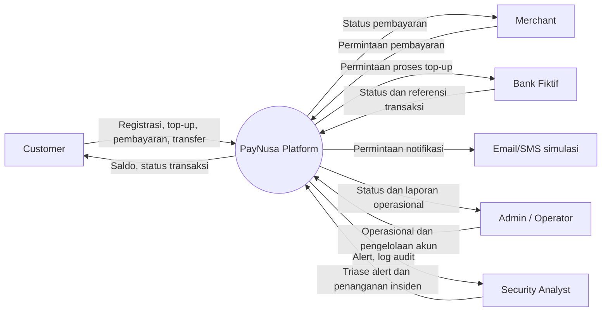
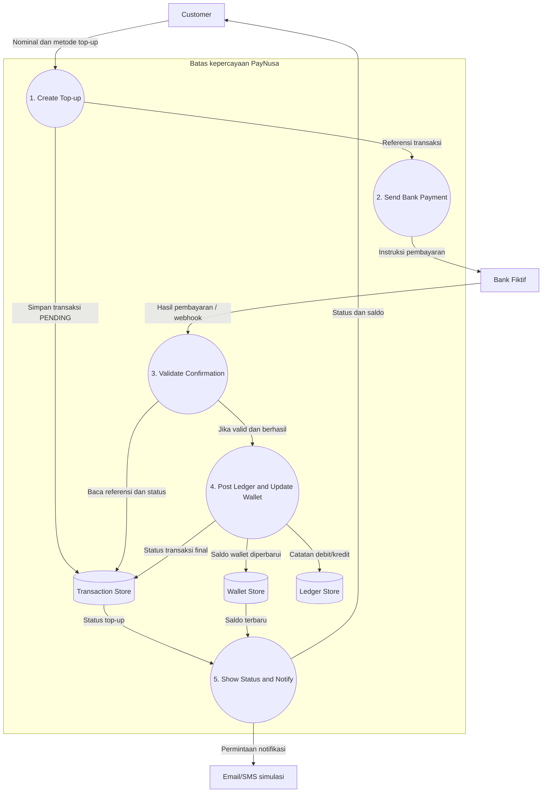
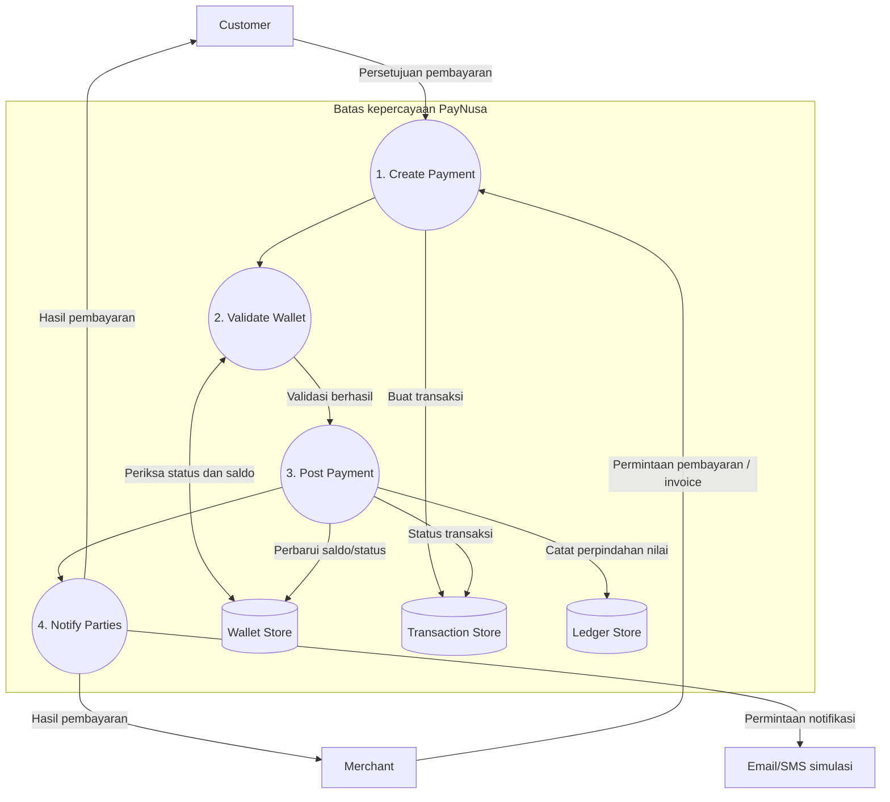

# PayNusa: Asset Inventory dan Data Flow Diagram (DFD)

- **Dokumen:** R&D Blueprint
- **Status:** Baseline awal
- **Versi:** 1.1
- **Tanggal:** 19 November 2026
- **Pemilik:** Ainur
- **Produk:** PayNusa
- **Klasifikasi:** Internal (simulasi portofolio)

---

## 1. Tujuan Dokumen

Dokumen ini menjadi blueprint awal untuk mengidentifikasi aset, batas sistem, aktor, dan aliran data pada proyek PayNusa.

Dokumen ini dibuat sebelum implementasi teknis agar keputusan arsitektur, keamanan, dan pengembangan memiliki dasar yang jelas. Dokumen ini harus konsisten dengan [Arsitektur C4](../architecture/02-c4.md) dan memakai istilah serta skema klasifikasi yang sama dengan kebijakan keamanan dan RACI.

## 2. Business Model yang Dikunci

PayNusa adalah **Digital Wallet & Payment Platform**:

> A Digital Wallet and Payment Infrastructure Platform.

Layanan utamanya:

1. **Digital Wallet:** registrasi pengguna, pengelolaan wallet dan saldo, top-up, serta transfer.
2. **Payment Services:** pembayaran ke merchant dan refund.
3. **Payment Integration:** integrasi API dengan bank atau payment provider, webhook, dan reconciliation.

### 2.1 Sistem Pendukung: Bank Fiktif

Bank Fiktif (di diagram C4 disebut *Bank Nusantara / Bank Simulator*) adalah sistem terpisah yang dibangun untuk simulasi dan berfungsi sebagai perantara top-up.

Cakupan Bank Fiktif:

- Mengelola data rekening simulasi.
- Mengelola saldo rekening simulasi.
- Memproses debit rekening sumber dan kredit rekening penampungan PayNusa untuk simulasi top-up.
- Mengirimkan status transaksi kepada PayNusa melalui API atau webhook.

Bank Fiktif **bukan** simulasi bank penuh dan tidak mencakup seluruh layanan perbankan.

### 2.2 Batasan Proyek

- Seluruh transaksi menggunakan uang dan saldo simulasi.
- Tidak menerima, menyimpan, atau memindahkan uang sungguhan.
- Tidak mengoperasikan layanan uang elektronik atau pembayaran riil.
- Bank Fiktif hanya mendukung kebutuhan simulasi top-up pada tahap awal.
- Implementasi dilakukan bertahap; daftar domain di bawah adalah peta tanggung jawab konseptual, bukan kewajiban membuat setiap layanan sebagai microservice sejak hari pertama.

**Keputusan bisnis dan batasan di atas merupakan baseline proyek. Perubahan hanya dilakukan jika pemilik proyek secara eksplisit membuka kembali keputusan tersebut.**

---

## 3. Aktor dan Pihak Eksternal

| Aktor / Pihak | Peran | Interaksi utama |
|---|---|---|
| Customer | Pengguna PayNusa | Registrasi, melihat saldo, top-up, transfer, dan membayar |
| Merchant | Penerima pembayaran | Membuat atau menerima permintaan pembayaran, melihat status transaksi |
| Admin / Operator | Pengelola operasional simulasi | Mengelola akun dan operasi harian sesuai hak akses |
| Security Analyst | Pemantau keamanan | Memantau alert dan menangani insiden |
| PayNusa | Platform inti | Mengelola wallet, transaksi, ledger, pembayaran, dan integrasi |
| Bank Fiktif | Sistem eksternal simulasi | Memproses top-up dari rekening simulasi dan mengirim status |
| Email/SMS (simulasi) | Sistem eksternal simulasi | Menerima permintaan pengiriman notifikasi |

Catatan: Merchant, Admin/Operator, dan Security Analyst adalah aktor konseptual. Detail portal, aplikasi, serta hak aksesnya ditetapkan pada desain berikutnya.

---

## 4. Batas Sistem (System Boundary)

### 4.1 Di Dalam Batas PayNusa

User Management, Authentication & Authorization, Wallet Management, Payment Processing, Transaction Management, Ledger, Merchant Management, Payment Integration, Notification, Reconciliation, Audit.

Komponen tersebut adalah domain/tanggung jawab logis. Pemisahan menjadi service, database, atau deployment unit ditentukan melalui desain arsitektur. Pemetaan awal ke service pada C4:

| Domain | Service di C4 | Catatan |
|---|---|---|
| Authentication & Authorization, User Management | Auth Service | Login, MFA, token, profil |
| Wallet Management, Ledger | Wallet Service | Saldo dan ledger |
| Payment Processing, Transaction Management, Payment Integration | Transaction Service | Top-up, transfer, pembayaran, hubungan ke Bank Fiktif |
| Notification | Notification Service | Mengirim ke Email/SMS simulasi |
| Audit | Audit Service | Log append-only dan deteksi |
| Merchant Management, Reconciliation | Belum ada di C4 | Ditentukan saat desain; C4 diperbarui jika dibuat sebagai service |
| (pintu masuk) | API Gateway | Routing, validasi, rate limiting |

### 4.2 Di Luar Batas PayNusa

- Customer dan perangkat yang digunakan.
- Merchant dan sistem merchant.
- Bank Fiktif beserta database dan API miliknya.
- Email/SMS simulasi.
- Payment provider lain yang mungkin diintegrasikan pada tahap berikutnya.

### 4.3 Prinsip Pemisahan Bank Fiktif

Bank Fiktif harus diperlakukan sebagai sistem eksternal walaupun dikembangkan oleh orang yang sama. Karena itu:

- Bank Fiktif memiliki batas sistem, API, dan penyimpanan datanya sendiri.
- PayNusa tidak membaca atau mengubah database Bank Fiktif secara langsung.
- Komunikasi dilakukan melalui kontrak API atau webhook yang terdokumentasi.
- Setiap permintaan dan notifikasi harus dapat dikorelasikan menggunakan referensi transaksi.

---

## 5. Gambaran Proses Bisnis Utama

### 5.1 Top-up Wallet

1. Customer memilih top-up dan memasukkan nominal.
2. PayNusa membuat transaksi top-up dengan status awal, misalnya `PENDING`.
3. PayNusa mengirim permintaan pembayaran ke Bank Fiktif.
4. Bank Fiktif memvalidasi rekening sumber dan kecukupan saldo simulasi.
5. Bank Fiktif memproses transaksi pada pembukuannya sendiri.
6. Bank Fiktif mengirim hasil transaksi ke PayNusa melalui respons API dan/atau webhook.
7. PayNusa memvalidasi keaslian, referensi, nominal, dan status notifikasi.
8. Jika valid dan berhasil, PayNusa mencatat jurnal ledger dan menambah saldo wallet secara konsisten.
9. PayNusa mengubah status transaksi dan memberi notifikasi kepada Customer.

**Kontrol penting:** Saldo wallet tidak boleh bertambah hanya karena Customer mengirim permintaan top-up. Penambahan saldo dilakukan setelah konfirmasi yang valid dan pemrosesan yang aman.

### 5.2 Pembayaran ke Merchant Menggunakan Wallet

1. Customer memulai pembayaran kepada Merchant.
2. PayNusa memvalidasi identitas, otorisasi, status wallet, dan saldo tersedia.
3. PayNusa membuat transaksi dengan referensi unik.
4. PayNusa mencatat perpindahan nilai pada ledger secara konsisten.
5. Saldo Customer berkurang dan kewajiban/hasil penerimaan Merchant dicatat sesuai model ledger.
6. PayNusa mengirim status pembayaran kepada Customer dan Merchant.

### 5.3 Transfer Antar Pengguna

1. Pengirim memasukkan penerima dan nominal.
2. PayNusa memvalidasi pengirim, penerima, status wallet, dan saldo.
3. PayNusa memproses debit dan kredit sebagai satu transaksi yang konsisten.
4. PayNusa menyimpan jejak audit dan mengirim notifikasi kepada kedua pihak.

### 5.4 Refund

1. Refund diajukan terhadap transaksi pembayaran yang sudah ada.
2. PayNusa memeriksa status transaksi dan kelayakan refund.
3. PayNusa memastikan refund tidak diproses lebih dari sekali.
4. PayNusa membuat transaksi refund baru yang terhubung ke transaksi asal.
5. Ledger diperbarui dan status diinformasikan kepada pihak terkait.

---

## 6. Asset Inventory: Daftar Aset Awal

Asset Inventory adalah daftar aset yang perlu dilindungi, dikelola, dan dipantau. Daftar berikut adalah **inventaris kandidat awal**; detail aktual seperti nama host, lokasi, pemilik teknis, klasifikasi final, dan kontrol yang diterapkan harus diperbarui saat implementasi.

Kolom **Pemilik** memakai nama peran yang sama dengan tabel RACI: Business Owner, Security Lead, Engineering Lead, Operations Lead. Aset milik pihak eksternal ditandai *(eksternal)*.

| ID | Aset | Kategori | Data / fungsi | Pemilik | Sensitivitas awal |
|---|---|---|---|---|---|
| AST-001 | Customer Profile Data | Data | Identitas dan profil pengguna | Engineering Lead | Rahasia |
| AST-002 | Authentication Data | Data / Security | Kredensial, hash password, sesi, token | Security Lead | Sangat rahasia |
| AST-003 | Wallet Records | Data | Akun wallet dan status wallet | Engineering Lead | Rahasia |
| AST-004 | Wallet Balance | Data keuangan | Saldo simulasi pengguna | Engineering Lead | Rahasia |
| AST-005 | Transaction Records | Data keuangan | Top-up, pembayaran, transfer, refund | Engineering Lead | Rahasia |
| AST-006 | Ledger Entries | Data keuangan | Catatan debit/kredit dan referensi transaksi (integritas kritis) | Engineering Lead | Sangat rahasia |
| AST-007 | Merchant Records | Data | Profil merchant dan konfigurasi | Engineering Lead | Rahasia |
| AST-008 | Payment Integration Credentials | Secret | API key, webhook secret, kredensial integrasi | Security Lead | Sangat rahasia |
| AST-009 | Bank Account Records | Data *(eksternal)* | Rekening simulasi pada Bank Fiktif | Bank Fiktif | Rahasia |
| AST-010 | Bank Transaction Records | Data keuangan *(eksternal)* | Debit/kredit dan status transaksi bank simulasi | Bank Fiktif | Rahasia |
| AST-011 | Application Source Code | Software | Kode sumber PayNusa dan Bank Fiktif | Engineering Lead | Internal |
| AST-012 | Application Configuration | Configuration | Environment dan konfigurasi aplikasi | Operations Lead | Rahasia |
| AST-013 | Database Systems (PostgreSQL) | Infrastructure | Penyimpanan data aplikasi | Operations Lead | Rahasia |
| AST-014 | Application/API Services | Software | Auth, Wallet, Transaction, Notification, Audit | Engineering Lead | Internal |
| AST-015 | Logs and Audit Trails | Data operasional | Aktivitas sistem, keamanan, dan perubahan | Security Lead | Rahasia |
| AST-016 | Backup and Recovery Copies | Data / Infrastructure | Salinan pemulihan data | Operations Lead | Rahasia |
| AST-017 | Deployment Pipeline (CI/CD) | Software / Process | Build, test, dan deployment | Operations Lead | Internal |
| AST-018 | SSH Keys and Signing Secrets | Secret | Akses server dan penandatanganan | Security Lead | Sangat rahasia |
| AST-019 | API Gateway | Software | Pintu masuk: routing, validasi, rate limiting | Engineering Lead | Internal |
| AST-020 | Event Bus (NATS) | Infrastructure | Pesan antar service, termasuk data transaksi | Operations Lead | Rahasia |
| AST-021 | Secret Manager (Vault/OpenBao) | Infrastructure / Secret | Penyimpan secret dan kunci enkripsi | Security Lead | Sangat rahasia |
| AST-022 | Admin Console / Akses Admin | Software / Akses | Antarmuka dan akun istimewa operator | Security Lead | Sangat rahasia |
| AST-023 | Container Images dan Dependensi | Software / Supply chain | Image, library, dan versi yang dipakai | Engineering Lead | Internal |
| AST-024 | Sertifikat TLS dan Domain | Infrastructure | Sertifikat dan konfigurasi domain | Operations Lead | Rahasia |
| AST-025 | Idempotency dan Webhook Store | Data operasional | Kunci idempotency, status webhook, proteksi replay | Engineering Lead | Rahasia |
| AST-026 | Data Uji Sintetis | Data | Pengguna dan saldo simulasi untuk pengujian | Engineering Lead | Internal |

### 6.1 Klasifikasi Sensitivitas

Skema empat level yang sama dengan kebijakan keamanan:

- **Sangat rahasia:** kebocoran atau perubahan tanpa izin dapat menyebabkan pengambilalihan akses, manipulasi transaksi, atau kompromi sistem (kredensial, secret, kunci, ledger).
- **Rahasia:** data pengguna, saldo, transaksi, dan operasional yang hanya boleh diakses peran yang berwenang.
- **Internal:** aset internal yang tidak untuk publik, tetapi dampak langsungnya lebih terbatas (kode, konfigurasi non-secret, pipeline).
- **Publik:** boleh dilihat siapa saja (misalnya README dan dokumentasi portofolio yang dipublikasikan). Belum ada aset yang diklasifikasikan di level ini.

Semua data pada proyek ini sintetis, tetapi diperlakukan seolah-olah nyata agar kebiasaan keamanannya sama. Klasifikasi ini adalah penilaian awal; validasi ulang setelah data dan implementasi nyata diketahui.

---

## 7. Data Flow Diagram (DFD)

### 7.1 DFD Level 0: Context Diagram

PayNusa dipandang sebagai satu proses utama.

### 7.2 DFD Level 1: Proses Top-up

Diagram ini menggambarkan alur logis, bukan urutan teknis final. Implementasi perlu menangani notifikasi duplikat, timeout, retry, transaksi yang terlambat, dan kegagalan parsial.

### 7.3 DFD Level 1: Pembayaran Merchant

### 7.4 Catatan DFD

- Panah menunjukkan perpindahan data, bukan selalu perpindahan uang.
- Data store menunjukkan penyimpanan logis; belum menetapkan teknologi database.
- Data store tidak berhubungan langsung dengan entitas eksternal; selalu lewat proses.
- Bank Fiktif dan Email/SMS adalah entitas eksternal terhadap PayNusa.
- Garis batas kepercayaan menjadi bahan untuk threat modeling (task 4).
- DFD Level 1 untuk transfer dan refund belum dibuat; ditambahkan jika diperlukan.
- Diagram perlu diperinci ketika kontrak API, service boundary, dan struktur data telah dirancang.

---

## 8. Batas Kepercayaan dan Kontrol Keamanan Awal

| Batas / area | Risiko yang perlu dipertimbangkan | Kontrol awal |
|---|---|---|
| Customer → PayNusa | Akses tidak sah dan penyalahgunaan akun | Authentication, authorization, rate limiting |
| Merchant → PayNusa | Permintaan palsu atau manipulasi nominal | API key, request signing, validasi input |
| PayNusa → Bank Fiktif | Permintaan palsu atau manipulasi nominal | API authentication, request signing, TLS |
| Bank Fiktif → PayNusa | Webhook palsu atau duplikat | Signature verification, idempotency, replay protection |
| PayNusa → Email/SMS | Kebocoran data pribadi lewat notifikasi | Data minimal di pesan, tanpa data sensitif |
| Admin → Sistem | Penyalahgunaan hak istimewa | Least privilege, MFA, audit logging |
| Service → Vault | Pencurian secret | Autentikasi service, akses minimal, audit akses |
| Aplikasi → Database | Kebocoran atau akses data berlebihan | Network restriction, access control, secret management |
| Backup dan log | Kebocoran data sensitif | Access restriction, encryption, retention policy |

Kontrol penting di dalam batas (bukan batas kepercayaan): **Payment → Ledger** berisiko saldo ganda atau pencatatan tidak konsisten; kontrolnya atomic transaction, immutable journal, dan audit trail.

Kontrol di atas adalah kebutuhan desain awal, bukan pernyataan bahwa seluruh kontrol sudah diimplementasikan.

---

## 9. Risiko dan Skenario Kegagalan yang Harus Ditangani

1. **Duplicate request:** permintaan top-up atau pembayaran terkirim lebih dari sekali.
2. **Duplicate webhook:** notifikasi transaksi yang sama diterima berulang kali.
3. **Timeout:** PayNusa tidak menerima respons, padahal Bank Fiktif sudah memproses transaksi.
4. **Invalid callback:** notifikasi berasal dari pihak yang tidak sah atau payload telah dimanipulasi.
5. **Partial failure:** satu sistem berhasil memproses, sedangkan sistem lain gagal memperbarui status.
6. **Ledger mismatch:** saldo wallet tidak sesuai dengan total catatan ledger.
7. **Unauthorized access:** pengguna atau operator mengakses data di luar kewenangannya.

Prinsip penanganan:

- Gunakan ID transaksi dan idempotency key yang konsisten.
- Jangan menganggap timeout sebagai transaksi gagal secara otomatis.
- Sediakan mekanisme pengecekan status transaksi.
- Catat setiap perubahan status dan aktivitas penting.
- Jangan mengubah atau menghapus histori ledger untuk menyamarkan kesalahan; gunakan entri koreksi yang dapat diaudit.

---

## 10. Hal yang Belum Ditentukan

Bagian ini sengaja dibiarkan terbuka agar tidak mengarang keputusan teknis sebelum waktunya.

| Area | Status |
|---|---|
| Nama dan daftar final microservices (termasuk Merchant dan Reconciliation) | Belum ditentukan |
| Satu database dengan schema per service, atau database per service | Belum ditentukan |
| Service saling memanggil langsung, atau hanya lewat event | Belum ditentukan |
| Format kontrak API Bank Fiktif | Belum ditentukan |
| Metode autentikasi API dan webhook | Belum ditentukan |
| Model ledger dan aturan akuntansi final | Perlu dirancang |
| Retensi log dan audit trail | Belum ditentukan |
| Klasifikasi data final | Perlu validasi |
| Infrastruktur deployment | Belum ditentukan |
| Detail settlement merchant | Perlu dirancang |

---

## 11. Definition of Done: R&D Asset Inventory & DFD

- [x] Aktor dan pihak eksternal sudah diidentifikasi.
- [x] Batas sistem PayNusa dan Bank Fiktif sudah jelas.
- [x] Aset data, software, infrastructure, dan secret sudah diinventarisasi.
- [x] Pemilik fungsi dan sensitivitas awal setiap aset sudah dicatat.
- [x] DFD Level 0 sudah menggambarkan interaksi utama.
- [x] DFD Level 1 top-up sudah menggambarkan aliran data utama.
- [x] DFD Level 1 pembayaran merchant sudah menggambarkan aliran data utama.
- [x] Trust boundary dan risiko utama sudah diidentifikasi.
- [x] Asumsi dan keputusan teknis yang belum ditentukan sudah dicatat.
- [ ] Review akhir oleh pemilik proyek.

---

## 12. Prinsip Baseline

Dokumen ini adalah blueprint R&D awal untuk proyek portofolio PayNusa. Business model dan batasan proyek yang telah disepakati menjadi acuan. Detail teknis dapat diperinci tanpa mengubah model bisnis yang telah dikunci.

**Prinsip utama: pahami aset dan aliran data terlebih dahulu, lalu turunkan kebutuhan keamanan dan desain teknis dari hasil analisis tersebut.**
