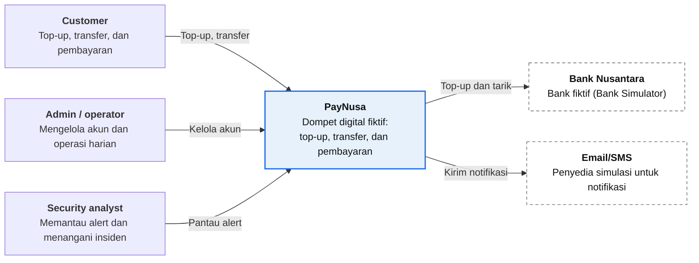
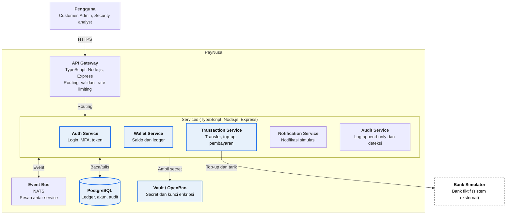

# Arsitektur C4: PayNusa

Dua level pertama dari [model C4](https://c4model.com): Context (Level 1) dan Container (Level 2). Level 3 dan 4 sengaja belum dibuat.

Catatan istilah: "container" di C4 berarti sesuatu yang berjalan dan menyimpan atau memproses data (service, database, event bus), bukan Docker container.

Catatan sintaks: diagram ditulis sebagai flowchart Mermaid yang bergaya C4. Sintaks C4 bawaan Mermaid (`C4Context`, `C4Container`) sempat diuji, tetapi tata letaknya otomatis dan menghasilkan panah yang menembus kotak serta label yang saling menimpa. Alasan lengkapnya ada di [ADR 0005](../adr/0005-diagram-mermaid-c4.md).

## Level 1: System Context

Tiga peran memakai PayNusa, yang bergantung pada dua sistem eksternal simulasi (garis putus-putus).

## Level 2: Container

Satu API Gateway di depan lima service, dengan event bus, database, dan Vault. Kotak biru menyimpan data sensitif (kredensial, saldo, transaksi, kunci). Garis putus-putus menandai sistem eksternal simulasi.

### Yang perlu diingat saat membaca diagram

- **Data sensitif** ada di Auth (kredensial), Wallet (saldo), Transaction (transaksi), PostgreSQL, dan Vault (kunci).
- **Trust boundary pertama** adalah garis antara PayNusa dan dunia luar (pengguna, Bank Simulator, Email/SMS). Ini dasar untuk threat modeling di task 4.
- **Panah dari kotak Services berlaku untuk semua service di dalamnya**, supaya diagram tetap terbaca. Satu-satunya relasi yang digambar per service adalah Transaction ke Bank Simulator. Service mana yang sebenarnya memakai database atau event bus ditentukan saat service dibuat.
- Cara service berkomunikasi: HTTP untuk yang mendesak dan event untuk efek samping, usulan di [ADR 0007](../adr/0007-komunikasi-antar-service.md) (menunggu persetujuan).
- Database: satu instance PostgreSQL, satu database per service ([ADR 0006](../adr/0006-database-per-service.md)).
